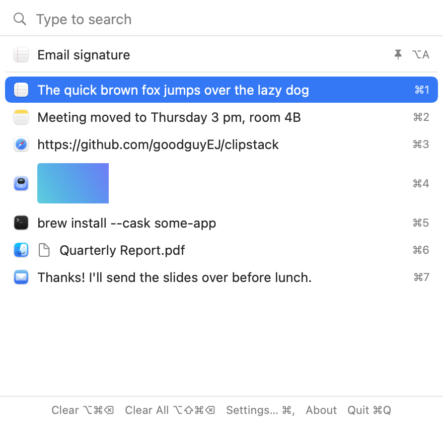
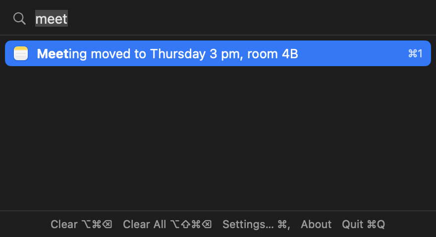
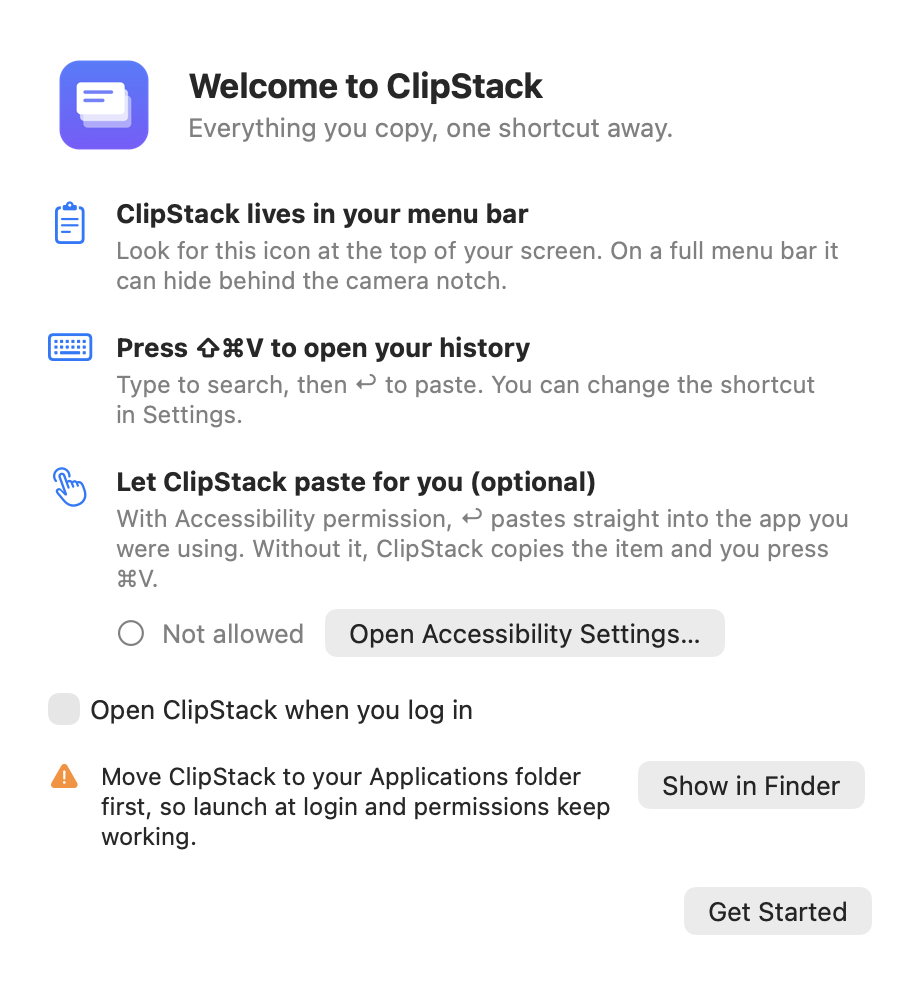

# ClipStack

A free, lightweight, keyboard-first clipboard history for macOS. It lives in your menu bar, remembers what you copy, and brings it back with one shortcut.



## Features

- **Remembers text (plain and rich), images and files.** Copying the same thing again moves it to the top instead of adding a duplicate.
- **Opens with ⇧⌘V** (you can change it). Type to search, ↩ to paste into the app you were using.
- **Search modes:** Exact, Fuzzy, Regex or Mixed, with matches highlighted.
- **Pins** with ⌥+letter shortcuts and custom titles. Pins never expire.
- **Preview** of the full text or image, where it came from, and when.
- **Private by default:**
  - skips copies that apps mark as private (many password managers do)
  - ignores Keychain Access, Passwords, 1Password, Bitwarden and KeePassXC out of the box
  - ignore lists for apps, clipboard types and text patterns
  - optional auto-forget after 1, 7 or 30 days
  - pause, or skip just the next copy
  - no network connections at all
- **Light:** about 2,900 lines of Swift, no dependencies. Idles at about 12 MB of memory and 0% CPU. Runs on Apple Silicon and Intel.



## Install

You need macOS 14 Sonoma or later.

### Option 1: build from source (recommended)

Building it yourself avoids any security warning, and takes about a minute.

1. Install Apple's command line tools if you don't have them (the full Xcode app isn't needed):

   ```bash
   xcode-select --install
   ```

2. Download and build:

   ```bash
   git clone https://github.com/goodguyEJ/clipstack.git
   cd clipstack
   ./build.sh
   ```

3. Move `build/ClipStack.app` into your **Applications** folder and open it.

### Option 2: download the app

1. Download `ClipStack-<version>.zip` from the [latest release](https://github.com/goodguyEJ/clipstack/releases/latest).
2. Optional: check it wasn't altered. Download the matching `.sha256` file into the same folder and run:

   ```bash
   shasum -a 256 -c ClipStack-*.zip.sha256
   ```

   You should see `OK`.
3. Unzip it and move **ClipStack.app** into your **Applications** folder.
4. Open it. ClipStack is free and not notarized by Apple (that costs $99 a year), so macOS will say it can't verify the app. To allow it once:
   - **macOS 15 Sequoia and later:**
     1. Click **Done** on the warning.
     2. Open **System Settings → Privacy & Security**.
     3. Scroll down to the message about ClipStack and click **Open Anyway**.
     4. Enter your password, then click **Open Anyway** again.
   - **macOS 14 Sonoma:** Control-click **ClipStack.app**, choose **Open**, then click **Open** in the dialog.

## First run

A welcome window shows where the menu bar icon is, your shortcut, and two optional steps:

- **Accessibility permission** lets ↩ paste straight into the app you were using. ClipStack only uses it to press ⌘V for you and to find your text cursor. Without it, ClipStack copies the item and you press ⌘V yourself.
- **Open at login.**

You can reopen it any time: right-click the menu bar icon, then choose **Welcome…**.



## Keep permissions across updates (optional)

macOS ties the Accessibility permission to how an app is signed. Each `./build.sh` normally produces a new signature, so after updating you may need to remove ClipStack from System Settings → Privacy & Security → Accessibility and add it again.

To avoid that, sign every build with your own certificate. This is for building from source; downloaded copies can't use your certificate.

```bash
scripts/make-signing-cert.sh
```

The script asks for your password once, to trust the certificate for code signing on your account. Then add the line it prints to your `~/.zshrc`:

```bash
export CLIPSTACK_SIGN_IDENTITY="ClipStack Self-Signed"
```

From then on, `./build.sh` signs with it, and the permission survives updates. The first switch to the certificate counts as a new app once, so grant Accessibility one more time. If the certificate can't be used, `./build.sh` says so and builds without it. Running the script again fixes a certificate that isn't trusted yet.

## Update

1. Quit ClipStack: right-click the menu bar icon, then choose **Quit ClipStack**.
2. Replace the app in Applications, from a new build (`git pull && ./build.sh`) or a new download.
3. Open it. Your history and settings are kept.
4. If auto-paste stopped working, remove ClipStack from System Settings → Privacy & Security → Accessibility and add it again.

## Keyboard shortcuts

| In the popup | Action |
|---|---|
| Type | Search |
| ↑ ↓ (⌃P ⌃N, ⌃K ⌃J) | Move. Add ⇧ to select several: images paste as images, anything else is joined as plain text |
| ⌘↑ ⌘↓, Home End | First / last |
| ↩ or click | Paste into the previous app (copy only, if "Paste automatically" is off) |
| ⌥↩ | The opposite of ↩ |
| ⌥⇧↩ | Paste with the formatting setting inverted |
| ⌘1 … ⌘9 | Pick one of the first nine items |
| ⌥ + letter | Paste that pin |
| ⌥P | Pin / unpin |
| ⌥⌫ | Delete |
| ⌥⌘⌫ / ⌥⇧⌘⌫ | Clear history / clear everything, including pins (both ask first) |
| ⌘, | Settings |
| ⎋ | Clear search, then close |

| Menu bar icon | Action |
|---|---|
| Click | Open the popup |
| ⌥-click | Pause / resume recording |
| ⌥⇧-click | Skip the next copy |
| Right-click | Menu |

## Privacy

- History is stored only on your Mac, in `~/Library/Application Support/ClipStack/`: a JSON file plus a `blobs/` folder for images and rich text.
- That folder is readable only by your account and is excluded from Time Machine.
- It is **not encrypted** by ClipStack. Turn on FileVault to encrypt it along with the rest of your disk.
- ClipStack can only skip a copy when the app marks it as private or is on the ignore list. Passwords copied from a browser extension, or typed into a note, are recorded like any other text. Pause ClipStack, use auto-forget, or delete them with ⌥⌫.
- ClipStack asks macOS to keep its popup out of screen sharing and recordings. Some capture apps ignore this, so pause or close ClipStack while sharing your screen.
- Search looks at the first 10,000 characters of each item in Exact mode, and the first 2,000 in Fuzzy and Regex mode.
- Clear and Clear All delete the history, together with any recovery backups. A recovery backup only appears if the history file ever fails to load.
- ClipStack makes no network connections.

## Uninstall

1. Quit ClipStack.
2. Delete **ClipStack.app** from Applications.
3. Delete your history and settings:

   ```bash
   rm -rf ~/Library/Application\ Support/ClipStack
   defaults delete io.github.goodguyej.clipstack
   tccutil reset Accessibility io.github.goodguyej.clipstack
   ```

4. If you turned on **Open at login**, check System Settings → General → Login Items and remove ClipStack if it's still listed.
5. If you created a signing certificate, remove it:

   ```bash
   security delete-identity -t -c "ClipStack Self-Signed"
   ```

## FAQ

**I can't see the menu bar icon.**
On a full menu bar, macOS hides icons behind the camera notch. Close some other menu bar apps, or open ClipStack with its shortcut. If you turned on "Hide menu bar icon", open the app again from Applications to get to Settings.

**Auto-paste stopped working after an update.**
Remove ClipStack from System Settings → Privacy & Security → Accessibility and add it again. If you build from source, you can avoid this in future: see [Keep permissions across updates](#keep-permissions-across-updates-optional).

**⇧⌘V does something else in Chrome, Slack or Google Docs.**
Those apps use ⇧⌘V for "paste as plain text". Pick a different shortcut in ClipStack's Settings → General. If another app has already taken your shortcut, ClipStack's menu shows "Shortcut unavailable".

**Why isn't it notarized?**
Notarization needs a paid Apple Developer account. ClipStack is free, so building from source is the warning-free way to install it.

## Scripting

```bash
defaults write io.github.goodguyej.clipstack ignoreEvents -bool true          # pause recording
defaults write io.github.goodguyej.clipstack ignoreOnlyNextEvent -bool true   # skip the next copy
defaults write io.github.goodguyej.clipstack historySize -int 500
open clipstack://open        # also: settings, pause
```

Any app or web page can open these links, so they can't weaken privacy. There's no link to resume recording, and a popup opened by a link only copies, never pastes.

## Project layout

| Path | Contents |
|---|---|
| `Sources/main.swift` | App delegate, menu bar icon, URL scheme |
| `Sources/Monitor.swift` | Clipboard polling and ignore rules |
| `Sources/Model.swift` | History store, persistence, writing back to the clipboard |
| `Sources/Popup.swift` | Popup panel, list, keyboard handling, preview |
| `Sources/Search.swift` | Exact, fuzzy and regex matching |
| `Sources/Keys.swift` | Global shortcut, shortcut recorder, paste, text-cursor lookup |
| `Sources/Welcome.swift` | First-run welcome window |
| `Sources/SettingsWindow.swift` | Settings tabs |
| `Sources/Prefs.swift`, `Sources/Display.swift` | Preferences and display helpers |
| `build.sh` | Universal build, signing and release zip (`./build.sh --release`) |
| `scripts/` | Icon generator, signing certificate, one-off migration from the old Clippy builds |
| `Resources/AppIcon.icns` | App icon (generated by `scripts/make-icon.swift`) |

## License

[MIT](LICENSE)
